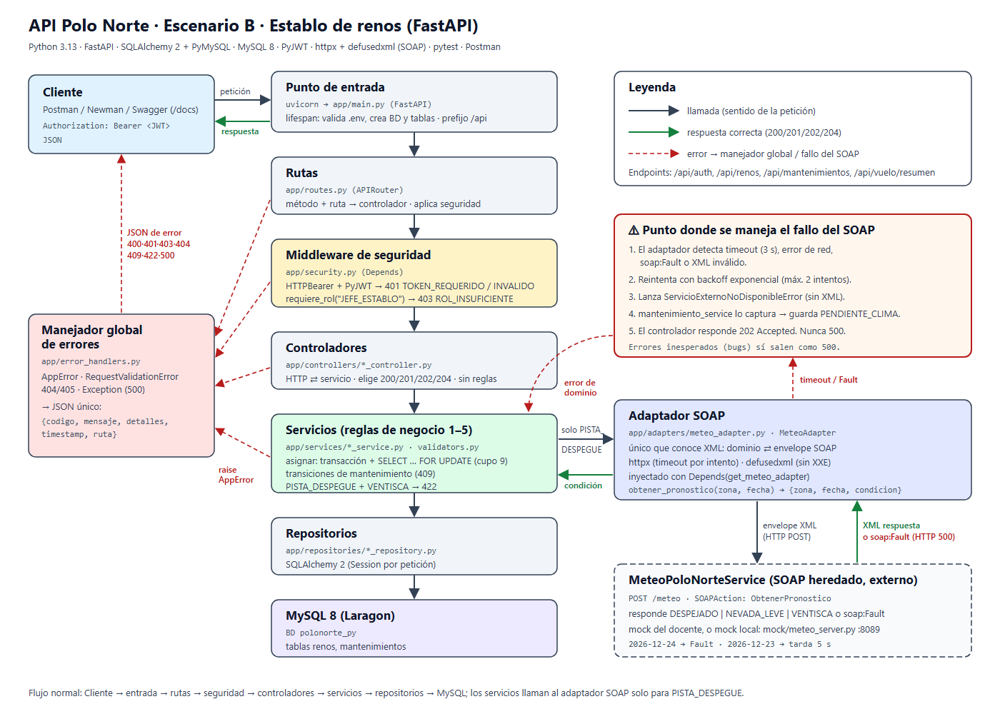

# 🦌 API Polo Norte · Escenario B · Establo de renos y mantenimiento del terreno (FastAPI)

API REST para gestionar los renos, las tareas de mantenimiento del terreno y la asignación al vuelo del 24 de diciembre. Se integra con el servicio SOAP heredado **MeteoPoloNorteService** y sigue funcionando cuando ese servicio falla.

**Stack:** Python 3.13 · FastAPI · Uvicorn · SQLAlchemy 2 + PyMySQL · MySQL 8 · PyJWT · httpx + defusedxml (SOAP) · pytest · Postman

---

## 1. Cómo levantar el proyecto

Requisitos: Python 3.11 o superior y MySQL 8 corriendo (por ejemplo, el de Laragon).

```powershell
python -m venv .venv
.venv\Scripts\activate
pip install -r requirements.txt
copy .env.example .env                     # luego edita los valores (ver sección 2)
python -m mock.meteo_server                # terminal 1 (opcional): mock SOAP local en http://127.0.0.1:8089/meteo
uvicorn app.main:app --reload --port 8000  # terminal 2: API en http://127.0.0.1:8000
```

- La API crea la base de datos `DB_NAME` y sus tablas al arrancar. No hace falta correr scripts SQL.
- Documentación interactiva (Swagger): **http://127.0.0.1:8000/docs**. El botón *Authorize* acepta el token.
- Para usar el **mock del docente**, pon su endpoint en `METEO_URL` y no levantes el mock local.
- Tests (usan la base `<DB_NAME>_test`, nunca la tuya): `pytest`
- Colección desde consola: `npx newman run postman/PoloNorte-EscenarioB-FastAPI.postman_collection.json`

> **Windows:** usa `127.0.0.1` en lugar de `localhost`. Windows intenta primero IPv6 (`::1`) y tarda unos 2 s en pasar a IPv4. Esa demora se come casi todo el timeout de 3 s del SOAP.

## 2. Variables de entorno

No hay secretos en el repositorio. `.env` está en `.gitignore` y `.env.example` solo trae valores de ejemplo. Si falta `JWT_SECRET`, la API no arranca.

| Variable | Descripción | Ejemplo |
|---|---|---|
| `PORT` | Puerto de referencia (se pasa a uvicorn con `--port`) | `8000` |
| `DB_HOST` / `DB_PORT` | Servidor MySQL | `127.0.0.1` / `3306` |
| `DB_USER` / `DB_PASS` | Credenciales MySQL | `root` / *(vacío en Laragon)* |
| `DB_NAME` | Base de datos | `polonorte_py` |
| `JWT_SECRET` | Clave para firmar los tokens (32+ caracteres aleatorios) | — |
| `JWT_EXPIRES` | Duración del token (`45s`, `30m`, `2h`, `1d`) | `2h` |
| `JEFE_USER` / `JEFE_PASSWORD` | Usuario de prueba con rol `JEFE_ESTABLO` | `jefe` / `jefe123` |
| `ELFO_USER` / `ELFO_PASSWORD` | Usuario de prueba con rol `ELFO` | `elfo` / `elfo123` |
| `METEO_URL` | Endpoint SOAP de MeteoPoloNorteService | `http://127.0.0.1:8089/meteo` |
| `METEO_SOAP_ACTION` | Cabecera SOAPAction | `ObtenerPronostico` |
| `METEO_TIMEOUT_MS` | Timeout por intento | `3000` |
| `METEO_MAX_INTENTOS` / `METEO_BACKOFF_MS` | Reintento con backoff exponencial | `2` / `300` |

Para generar un `JWT_SECRET`: `python -c "import secrets; print(secrets.token_urlsafe(48))"`

## 3. Usuarios y tokens de prueba

```http
POST /api/auth/login
Content-Type: application/json

{ "username": "jefe", "password": "jefe123" }
```

Responde `{ "token": "...", "rol": "JEFE_ESTABLO" }`. El token (JWT HS256) se envía como `Authorization: Bearer <token>`.

| Usuario | Rol | Resultado en endpoints protegidos |
|---|---|---|
| `jefe` | `JEFE_ESTABLO` | permitido |
| `elfo` | `ELFO` | **403** ROL_INSUFICIENTE |
| *(sin token o token inválido)* | — | **401** TOKEN_REQUERIDO / TOKEN_INVALIDO |

La colección de Postman hace el login y guarda los tokens automáticamente.

## 4. Arquitectura



📄 [docs/arquitectura.png](docs/arquitectura.png) (fuente editable: [docs/arquitectura.svg](docs/arquitectura.svg))

```
Postman → app/main.py → app/routes.py → [app/security.py: JWT + rol] → app/controllers → app/services → app/repositories → MySQL
                                                                                          └→ app/adapters/meteo_adapter.py → SOAP MeteoPoloNorteService
                   cualquier capa: raise AppError → app/error_handlers.py → JSON estándar
```

| Capa | Archivo(s) | Responsabilidad |
|---|---|---|
| Entrada | `app/main.py` | FastAPI, lifespan (valida `.env`, crea BD y tablas), prefijo `/api` |
| Rutas | `app/routes.py` | Mapear método y ruta al controlador y aplicar la seguridad |
| Seguridad | `app/security.py` | Dependencias de FastAPI: verificar el JWT (401) y el rol (403) |
| Controladores | `app/controllers/*` | Traducir HTTP ↔ servicio, validar el `{id}` y elegir el código de éxito. **Sin reglas.** |
| Servicios | `app/services/*`, `app/validators.py` | **Todas las reglas de negocio** y validaciones |
| Repositorios | `app/repositories/*` | Acceso a datos (SQLAlchemy) |
| Adaptador SOAP | `app/adapters/meteo_adapter.py` | Único que conoce XML: dominio ⇄ envelope, timeout, reintentos |
| Errores | `app/error_handlers.py` | Formato único de error para todas las respuestas |

En FastAPI el "middleware" de seguridad son **dependencias** (`Depends`): se declaran en la ruta y corren antes del controlador. El adaptador SOAP también se inyecta con `Depends(get_meteo_adapter)`, así los tests lo reemplazan sin tocar el código.

### Formato único de error

```json
{
  "codigo": "TRANSICION_INVALIDA",
  "mensaje": "No se puede pasar de PROGRAMADO a COMPLETADO",
  "detalles": ["desde PROGRAMADO solo se permite: EN_CURSO, CANCELADO"],
  "timestamp": "2026-12-01T10:15:00.000Z",
  "ruta": "/api/mantenimientos/7/estado"
}
```

| HTTP | Códigos |
|---|---|
| 400 | `VALIDACION`, `JSON_INVALIDO`, `ID_INVALIDO` |
| 401 | `TOKEN_REQUERIDO`, `TOKEN_INVALIDO`, `CREDENCIALES_INVALIDAS` |
| 403 | `ROL_INSUFICIENTE` |
| 404 | `RENO_NO_ENCONTRADO`, `MANTENIMIENTO_NO_ENCONTRADO`, `RUTA_NO_ENCONTRADA` |
| 405 | `METODO_NO_PERMITIDO` |
| 409 | `TRANSICION_INVALIDA`, `RENO_NO_DISPONIBLE`, `ENERGIA_INSUFICIENTE`, `CUPO_VUELO_COMPLETO`, `RENO_ASIGNADO_NO_ELIMINABLE`, `NOMBRE_DUPLICADO`, `ESTADO_NO_PERMITIDO` |
| 422 | `PRONOSTICO_VENTISCA` |
| 500 | `ERROR_INTERNO` (solo errores inesperados; nunca por culpa del SOAP) |

FastAPI responde 422 por defecto cuando la entrada es inválida. Aquí se cambió a **400 `VALIDACION`**, porque el enunciado reserva el 422 para la regla 4.

### Reglas de negocio (todas en `app/services`)

1. Pasar a `ASIGNADO_VUELO` exige estar `DISPONIBLE` y tener `nivelEnergia ≥ 70` → `reno_service.asignar`.
2. Máximo 9 renos asignados. Se cuenta dentro de una transacción con `SELECT … FOR UPDATE`, así dos peticiones simultáneas no pueden dejar 10 → `reno_service.asignar`. **El conteo se bloquea antes que el reno:** con el orden inverso, dos asignaciones simultáneas de renos distintos se bloquean entre sí (deadlock) y una termina en 500. Hay un test que lanza 4 asignaciones a la vez para comprobarlo.
3. Transiciones `PROGRAMADO → EN_CURSO | CANCELADO` y `EN_CURSO → COMPLETADO`; cualquier otra responde 409 → `mantenimiento_service.TRANSICIONES`.
4. En `PISTA_DESPEGUE` se consulta el clima; si el pronóstico es `VENTISCA` responde 422 → `mantenimiento_service.crear`.
5. No se puede eliminar un reno `ASIGNADO_VUELO` → `reno_service.eliminar`.

Además, `POST`/`PUT` no permiten poner `ASIGNADO_VUELO` directamente (409), para que nadie se salte las reglas 1 y 2. Un reno que ya está asignado tampoco puede bajar de 70 de energía con `PUT`.

### Fallo del servicio SOAP (timeout de 3 s o Fault)

1. `MeteoAdapter` detecta el timeout, el error de red, el `soap:Fault` o una respuesta inválida, y **reintenta con backoff** (máximo 2 intentos).
2. Si sigue fallando, lanza `ServicioExternoNoDisponibleError`, un error de dominio que no tiene nada de XML.
3. `mantenimiento_service` lo captura y **guarda el mantenimiento como `PENDIENTE_CLIMA`**.
4. El controlador responde **`202 Accepted`**:

```json
{
  "mensaje": "Mantenimiento recibido. El servicio meteorológico no respondió; se confirmará cuando esté disponible.",
  "motivo": "soap:Server: Estación sin señal",
  "intentos": 2,
  "mantenimiento": { "id": 4, "estado": "PENDIENTE_CLIMA", "...": "..." }
}
```

La API nunca responde 500 por culpa del servicio externo. Un error de programación sí sale como 500, para no esconder bugs. Para provocar el Fault se envía `fechaProgramada: "2026-12-24"`. En el peor caso (timeout en los dos intentos) la respuesta tarda unos 6,3 s.

El XML se lee con `defusedxml`, que bloquea ataques XXE y "billion laughs" si el servicio externo devolviera XML malicioso.

## 5. Endpoints

| Método | Ruta | Seguridad | Éxito |
|---|---|---|---|
| POST | `/api/auth/login` | pública | 200 |
| POST | `/api/renos` | `JEFE_ESTABLO` | 201 |
| GET | `/api/renos?estado=` | pública | 200 |
| GET | `/api/renos/{id}` | pública | 200 |
| PUT | `/api/renos/{id}` | `JEFE_ESTABLO` | 200 |
| DELETE | `/api/renos/{id}` | `JEFE_ESTABLO` | 204 |
| PATCH | `/api/renos/{id}/asignacion` | `JEFE_ESTABLO` | 200 |
| POST | `/api/mantenimientos` | pública | 201 / **202** si el SOAP falla |
| GET | `/api/mantenimientos?zona=` | pública | 200 |
| PATCH | `/api/mantenimientos/{id}/estado` | pública | 200 |
| GET | `/api/vuelo/resumen` *(extra)* | pública | 200 |
| GET | `/health` | pública | 200 |

**Extras implementados:** `GET /api/vuelo/resumen` (renos asignados, energía promedio y `vueloListo` = 9 renos y la pista con un mantenimiento `COMPLETADO`), reintento con backoff antes de declarar caído el SOAP y Swagger en `/docs`.

## 6. Evidencias

- **Colección Postman:** [postman/PoloNorte-EscenarioB-FastAPI.postman_collection.json](postman/PoloNorte-EscenarioB-FastAPI.postman_collection.json), con 34 requests. Ejecútala en orden con *Run collection*.
  - Cubre 200, 201, 202, 204, 400, 401, 403, 404, 409 y 422. Cada request valida su código y un test a nivel de colección valida el formato de error en toda respuesta ≥ 400.
  - Al final libera y borra el reno que creó, así se puede correr muchas veces sin llenar el cupo de 9.
  - Las variables `fechaDespejada` (`2026-12-19`), `fechaVentisca` (`2026-12-21`) y `fechaFault` (`2026-12-24`) siguen las reglas del mock local. Ajusta `fechaVentisca` a una fecha en la que el mock del docente responda VENTISCA.
  - Se genera con `python scripts/generar_postman.py`. Si cambias el script, vuelve a generarla.
- **Tests automáticos:** `pytest` corre 63 tests: la API completa contra MySQL (incluida la concurrencia de la regla 2) y el adaptador SOAP contra el mock real por HTTP (éxito, Fault, timeout, servicio apagado y XML inválido).
- **Mock SOAP local** (`mock/meteo_server.py`), según la fecha:

| Fecha | Respuesta |
|---|---|
| `2026-12-24` | `soap:Fault` "Estación sin señal" |
| `2026-12-23` | tarda 5 s (provoca el timeout) |
| día múltiplo de 3 (ej. `2026-12-21`) | `VENTISCA` |
| día par (ej. `2026-12-20`) | `NEVADA_LEVE` |
| resto (ej. `2026-12-19`) | `DESPEJADO` |

## 7. Respuesta: ¿y si fueran microservicios?

Separaría tres servicios, cada uno con su propia base de datos. **Establo**: renos, energía, estado y asignación al vuelo (reglas 1, 2 y 5). **Mantenimiento**: zonas, tareas, transiciones y pronósticos (reglas 3 y 4); es el único que habla con el SOAP. **Identidad**: usuarios, roles y emisión de JWT; los demás solo validan la firma. Se comunican por REST y eventos (`MantenimientoCompletado`), sin compartir tablas.

Si el 24 de diciembre a las 23:00 cae Mantenimiento, Establo sigue registrando y asignando renos porque no lo necesita en línea. Solo `GET /vuelo/resumen` pierde el dato de la pista: con timeout corto y circuit breaker usaría el último evento recibido o marcaría ese dato como no disponible, sin tumbar el resto. Si cae Identidad, los tokens emitidos siguen valiendo hasta expirar. Si cae el SOAP: `PENDIENTE_CLIMA` y 202.

## 8. Decisiones y qué cambiaría con más tiempo

- `PENDIENTE_CLIMA` no tiene transiciones de salida porque el enunciado dice que cualquier transición fuera de las listadas responde 409. Con más tiempo agregaría una tarea programada que reintente el SOAP y pase los pendientes a `PROGRAMADO` o `CANCELADO`.
- La validación es manual (en `app/validators.py`) en lugar de modelos Pydantic, para dar mensajes en español, rechazar `"5"` o `true` como números y responder 400 con el formato único.
- Circuit breaker sobre el adaptador, migraciones con Alembic en lugar de `create_all()`, usuarios en base de datos con contraseñas hasheadas (bcrypt) y un cliente HTTP asíncrono para no ocupar un hilo durante la espera del SOAP.
